<div align="center">


**Conquer the world, one tile at a time.**

A real-time territory conquest game in pixel art, written in Lua with LÖVE. Inspired by [OpenFront.io](https://openfront.io).

[](https://github.com/0xS4cha/athena/actions/workflows/ci.yml)
[](https://github.com/0xS4cha/athena/actions/workflows/build.yml)
[](LICENSE)


[**Quick start**](#quick-start) · [Gameplay guide](docs/GAMEPLAY.md) · [Technical guide](docs/TECHNICAL.md) · [Report a bug](https://github.com/0xS4cha/athena/issues) · [Contribute](https://github.com/0xS4cha/athena/pulls)

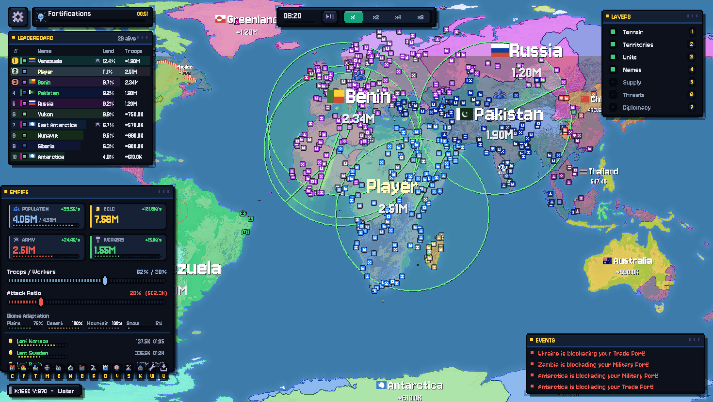

</div>

---

## Table of contents

- [Overview](#overview)
- [Features](#features)
- [Quick start](#quick-start)
- [Controls](#controls)
- [Tech stack](#tech-stack)
- [Architecture](#architecture)
- [Testing](#testing)
- [Documentation](#documentation)
- [Contributing](#contributing)
- [Acknowledgements](#acknowledgements)
- [License](#license)

## Overview

You start with a few tiles on one of 100 maps, alongside AI nations, wild tribes and other players. Expand, trade, negotiate, betray and launch nukes until one empire controls 80% of the land.

<div align="center">

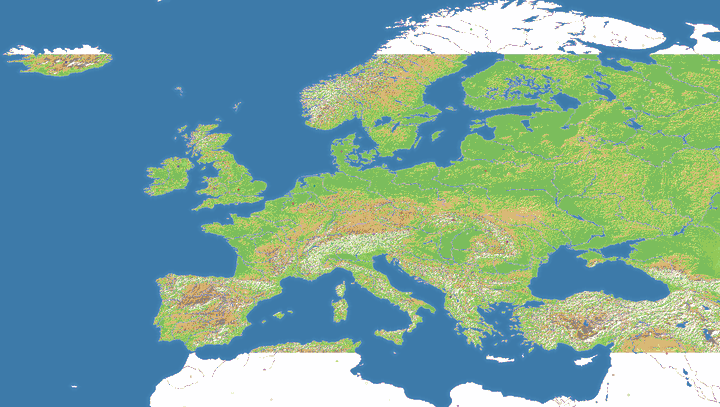

*23 minutes of a game on Europe, played by the AI, in a few seconds.*

</div>

Every game is multiplayer under the hood: even a solo game runs a local server in a background thread, like Minecraft. The simulation is fully deterministic, which is what makes reconnections, snapshots and replays possible.

## Features

### War on land, at sea and from the sky

| System | What it gives you |
| --- | --- |
| **Fronts** | Attacks advance tile by tile. Terrain, biome, supply lines, troop density, defense posts and fallout all change the cost. |
| **14 buildings and ships** | Cities, farms, mines, ports, factories with animated rails, barracks, radars, silos, SAMs, bunkers, warships and submarines. |
| **Navy** | Transport invasions, blockades, captured trade ships, and submarines that stay hidden until sonar or a radar finds them. |
| **Nukes** | Atom bombs, hydrogen bombs and MIRVs, with a blast preview, flight time, interception, shelter and lasting fallout. |
| **Fog of war** | Enemy structures are only visible near your land. Silos and SAMs stay hidden until a radar sweeps them, for the AI as well. |

<table>
<tr>
<td width="50%">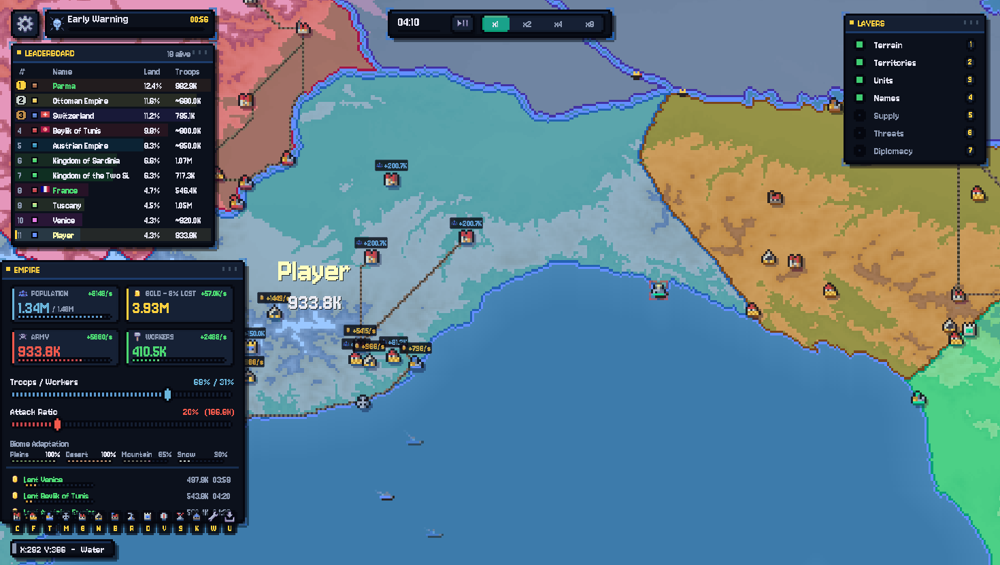<p align="center"><sub>Every structure shows what it brings, right on the map</sub></p></td>
<td width="50%">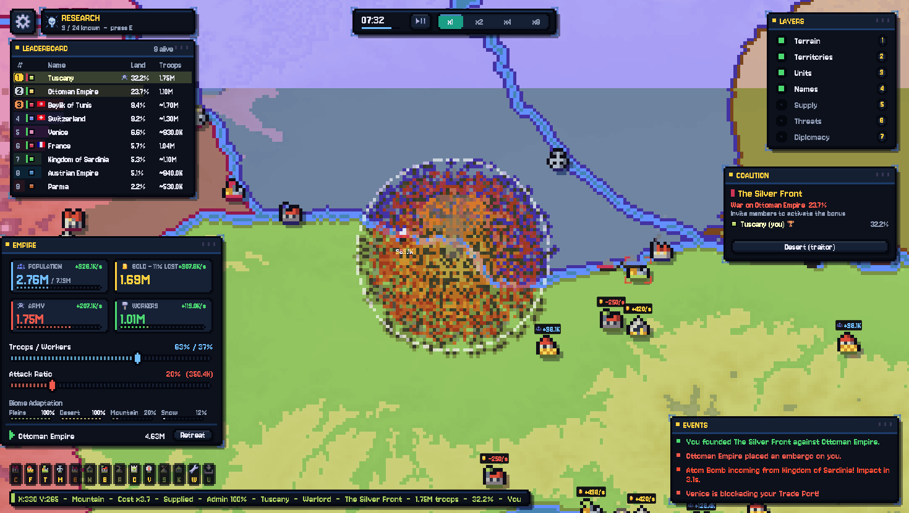<p align="center"><sub>Nuked land loses its owner and stays covered in fallout</sub></p></td>
</tr>
</table>

### Research tree

Press <kbd>E</kbd> to open 24 technologies in four branches. Each branch asks you to choose **one doctrine**, a strong bonus with a real drawback, so that two empires never play alike.

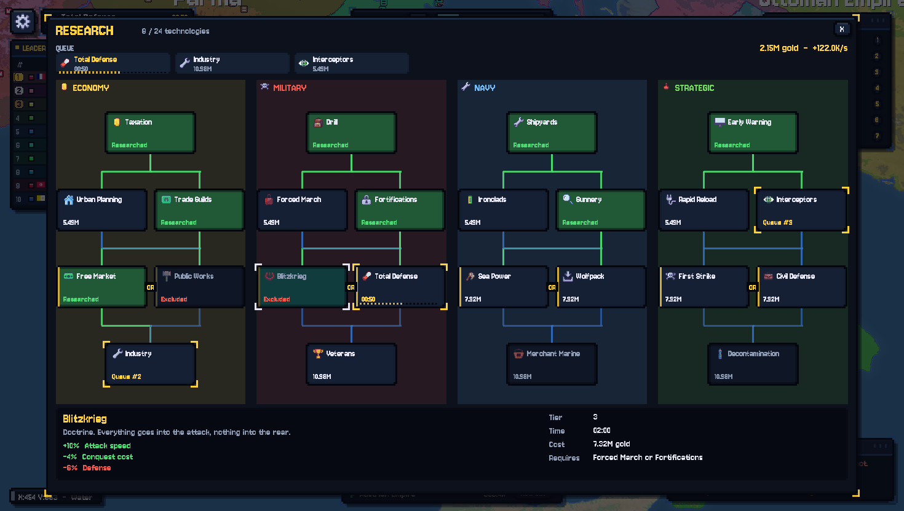

- **Paid over time**: with little gold, research slows down and takes half of your income, so it never blocks your buildings.
- **Priced on your income**: a large empire pays more, which limits snowballing.
- **Shared and stolen**: allies make technologies cheaper, and capturing a capital steals plans from your enemy.

### Diplomacy and AI

| System | What it gives you |
| --- | --- |
| **Alliances and pacts** | Shared vision, donations, non-aggression pacts with a notice period. Betrayal marks you as a traitor. |
| **Loans** | Borrow from any nation with negotiated interest. A default costs you dearly. |
| **Coalitions** | Blocs of up to six nations that band together against whoever dominates, or for mutual defense. |
| **AI personalities** | Warlords, Merchants, Guardians, Diplomats and Opportunists attack, build, negotiate and research in their own way. |
| **Map layers** | Press a key to see your supply range, the threats on your borders or the relations between nations. |

### Your game, your rules

Pick a mode or tune every rule: land to win, time limit, starting gold and army, income, spawn time, research, nukes and diplomacy.

<table>
<tr>
<td width="50%">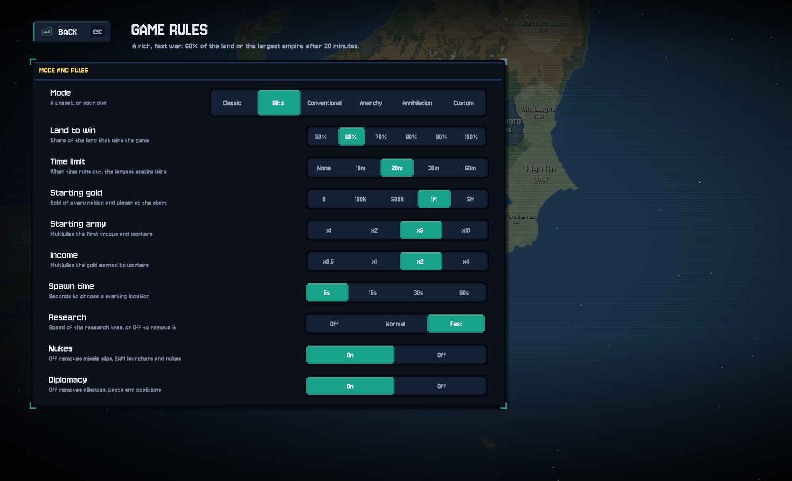<p align="center"><sub>Classic, Blitz, Conventional, Anarchy, Annihilation or Custom</sub></p></td>
<td width="50%">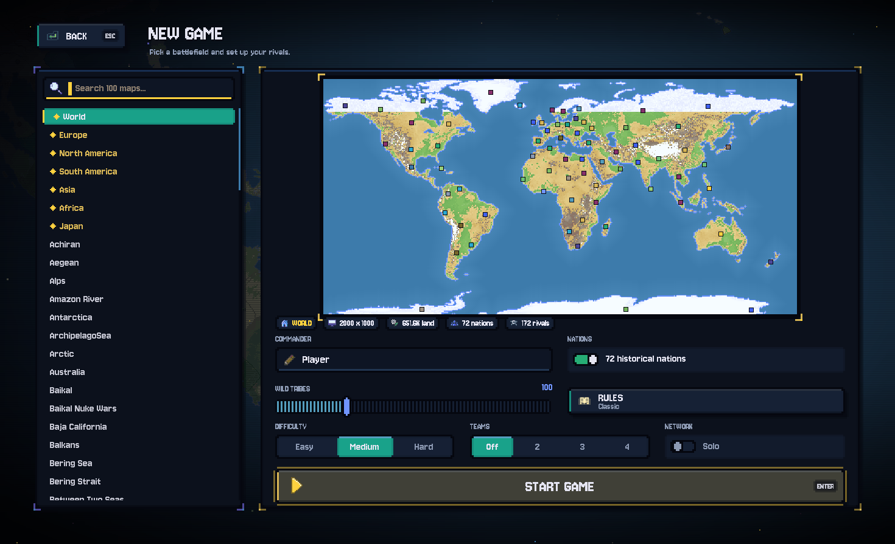<p align="center"><sub>100 maps, from Iceland to the whole world</sub></p></td>
</tr>
</table>

### Multiplayer

- **Authoritative tick-lockstep**: the server validates every action and clients stay in sync, checked by a state hash.
- **Reconnection**: a short disconnection replays the missing frames, a long one restores a snapshot.
- **LAN and dedicated servers**: host from the menu with automatic discovery, or run `love . --server`, also available as a Docker image.
- **Lobby**: passwords, colors, flags, teams, ready checks, chat and ping.
- **Team games, surrender and rematch votes**, with a shared victory.

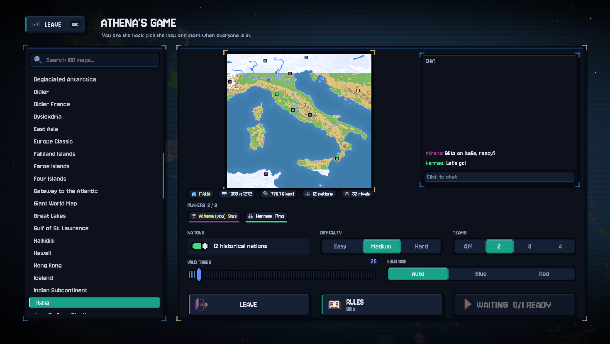

### Replays

Every game is saved automatically and weighs almost nothing, since only the commands are stored. Watch it again with the whole map revealed, change the speed and jump anywhere on the timeline.

<table>
<tr>
<td width="50%">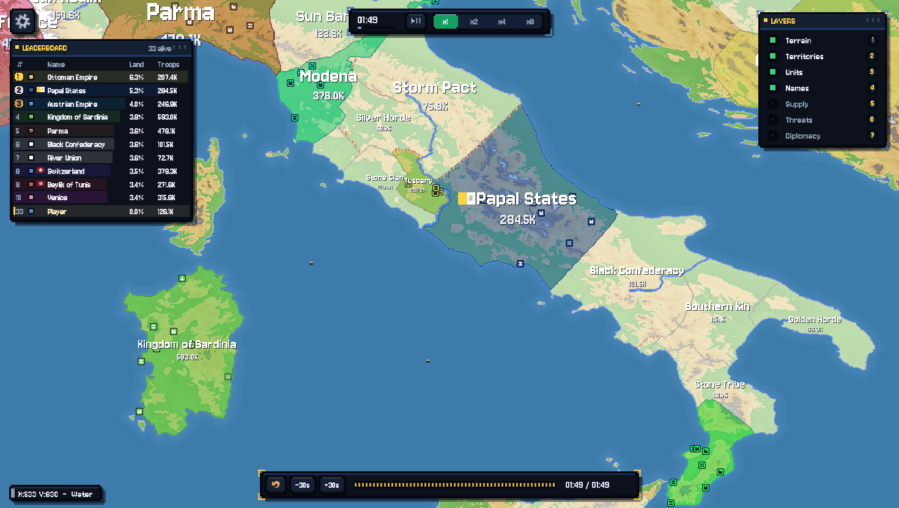<p align="center"><sub>Pause, speed and a timeline you can click</sub></p></td>
<td width="50%">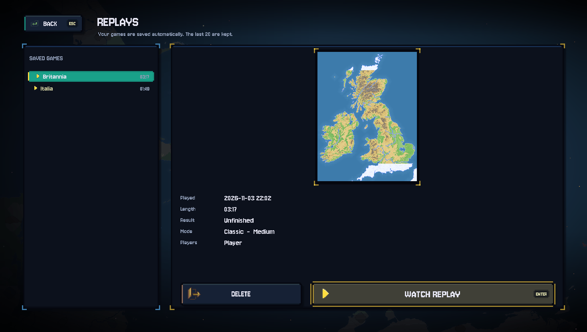<p align="center"><sub>Your last 20 games, ready to watch</sub></p></td>
</tr>
</table>

### And also

<table>
<tr>
<td width="50%">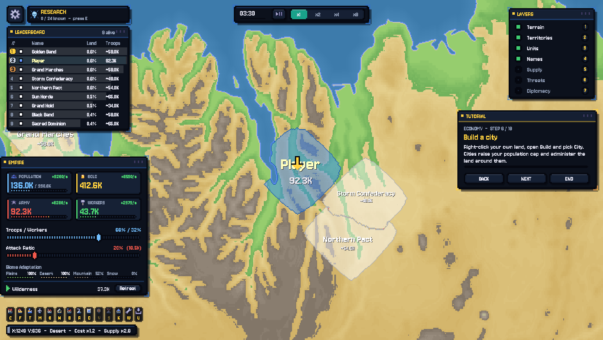<p align="center"><sub>An interactive tutorial with arrows on the map</sub></p></td>
<td width="50%">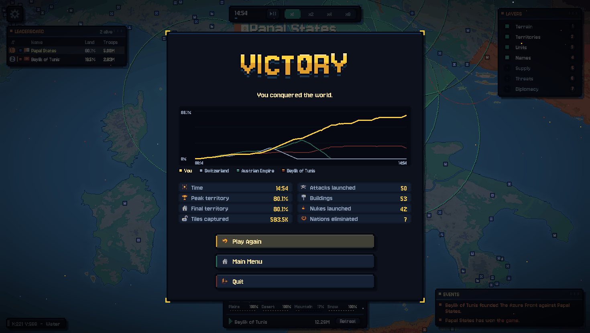<p align="center"><sub>End screens that chart your whole game</sub></p></td>
</tr>
<tr>
<td colspan="2">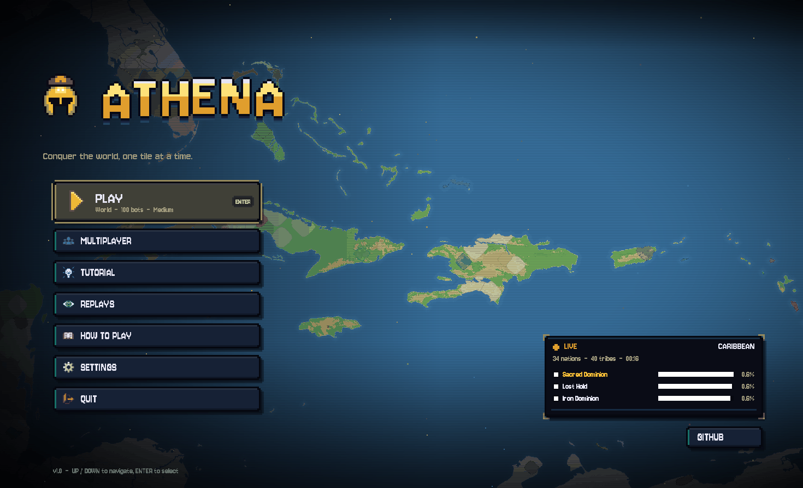<p align="center"><sub>AI nations fight a real battle behind the main menu</sub></p></td>
</tr>
</table>

- **Procedural sound**: every effect is synthesized at startup, with no audio file.
- **Rebindable hotkeys** for every building and nuke.

## Quick start

### Prerequisites

- [LÖVE](https://love2d.org/) **11.3 or newer**

### Run

```bash
git clone https://github.com/0xS4cha/athena.git
cd athena
love .
```

New to the game? Press **Tutorial** in the main menu.

### Commands

| Command | Description |
| --- | --- |
| `love .` | Start the game. |
| `love . --server --port 6789` | Run a dedicated server. |
| `love . --test` or `make test` | Run the test suite. |
| `make build` | Package Windows, macOS and Linux builds into `dist/`. |

Every other flag is listed in the [technical guide](docs/TECHNICAL.md#command-line).

## Controls

| Input | Action |
| --- | --- |
| <kbd>Left click</kbd> | Spawn, attack or send a boat |
| <kbd>Right click</kbd> | Context menu: build, nukes, diplomacy |
| <kbd>Right drag</kbd> / <kbd>Wheel</kbd> | Move the camera / zoom |
| <kbd>Space</kbd> | Start the game during the spawn phase |
| <kbd>E</kbd> | Open the research tree |
| <kbd>P</kbd> / <kbd>+</kbd> <kbd>-</kbd> | Pause / game speed, in solo |
| <kbd>1</kbd> to <kbd>7</kbd> | Toggle map layers |
| <kbd>Enter</kbd> | Chat in multiplayer |
| <kbd>H</kbd> / <kbd>Esc</kbd> | Controls help / pause menu |

## Tech stack

| Layer | Technologies |
| --- | --- |
| **Engine** | [LÖVE](https://love2d.org/), LuaJIT and its FFI for the tile arrays |
| **Simulation** | Fixed 10 ticks per second, seeded RNG, deterministic math, intent queue |
| **Network** | ENet, a custom binary protocol, zlib compressed snapshots |
| **Rendering** | One patched `ImageData` for the territories, palette shaders, pixel art drawn on the tile grid |
| **Tooling** | Headless test suite, GitHub Actions, LuaLS, Docker, love-build |

## Architecture

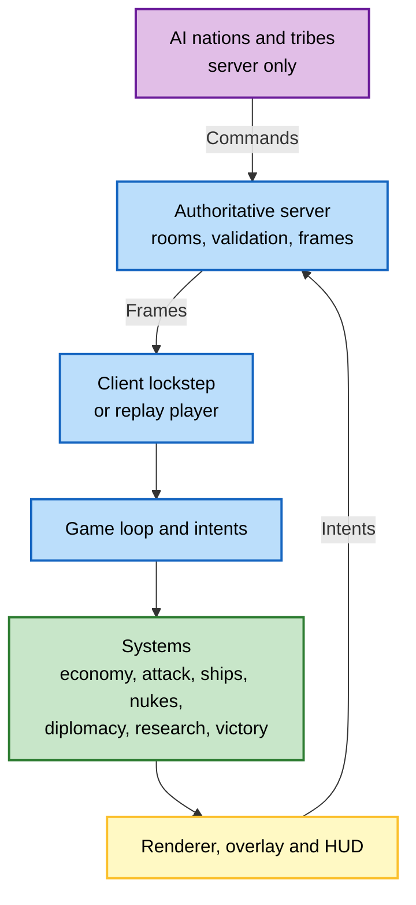

The full project structure is in the [technical guide](docs/TECHNICAL.md#project-structure).

## Testing

```bash
love . --test                     # or: make test
love . --test --filter network    # only the matching cases
```

The suite runs headless, and the CI runs it on every push along with a simulated game and a networked one. It covers the binary protocol, determinism between server, clients and snapshots, real ENet clients, balance, the AI, and every system from teams to research. See the [technical guide](docs/TECHNICAL.md#tests).

## Documentation

| Guide | Content |
| --- | --- |
| [**Gameplay guide**](docs/GAMEPLAY.md) | Every mechanic in detail: economy, war, buildings, diplomacy, research, rules, replays. |
| [**Technical guide**](docs/TECHNICAL.md) | Networking, command line, project structure, builds, tests and the map format. |

## Contributing

Issues and pull requests are welcome. Please read the [code of conduct](CODE_OF_CONDUCT.md) first, and run `make test` before opening a pull request.

## Acknowledgements

- [OpenFront.io](https://openfront.io), the original game and the source of the map assets
- [LÖVE](https://love2d.org/) and [LuaJIT](https://luajit.org/ext_ffi.html)
- [Jersey 10](https://fonts.google.com/specimen/Jersey+10), the pixel font of the interface

## License

Released under the [MIT License](LICENSE).
