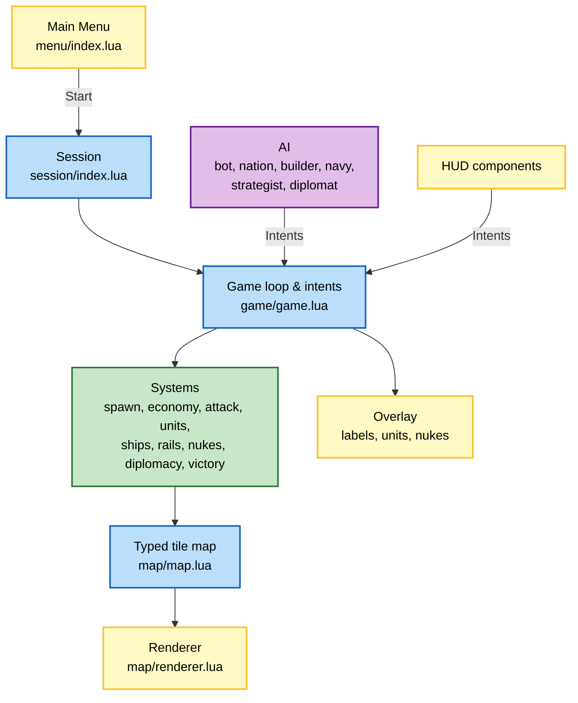

# Athena

A real-time territory conquest game inspired by [OpenFront.io](https://openfront.io), written in Lua with Love2D.

## Authors

- [@0xS4cha](https://github.com/0xS4cha)
- [@Bananoo](https://github.com/B4nJuice)

## Description

Athena is a single-player clone of OpenFront. You spawn on one of the 100+ bundled maps alongside AI nations and bots, then expand, trade, wage war, and launch nukes until one empire controls 80% of the land.

The simulation runs on a fixed 10 ticks-per-second loop with a seeded RNG. Every player action, human or AI, goes through an intent queue that is processed at the start of each tick. Tile data lives in LuaJIT FFI arrays (`uint8` terrain, `uint16` owner, `uint8` fallout), and the territory layer is a single `ImageData` patched pixel by pixel and uploaded once per frame.



## Setup

Athena runs on Love2D 11.3 or newer (it relies on `ImageData:getFFIPointer`).

```bash
love .
```

## Gameplay

- **Spawn phase**: click anywhere on land to choose your starting location, then press `Space` or wait for the countdown.
- **Population**: your maximum population grows with your territory and your cities. Growth is fastest when you are far from the cap.
- **Troops / Workers**: the slider splits your population. Troops attack and defend; workers produce gold.
- **Attacks**: left-click a neighbour (or the wilderness) to send `Attack Ratio` percent of your troops. The front advances tile by tile. Each tile costs troops depending on terrain (plains < highland < mountain), fallout, the defender's troop density, defense posts, and whether the defender is a traitor. Attacks can be retreated from the Empire panel, and opposite attacks cancel each other out.
- **Biomes**: land is plains, desert, mountain or snow, derived from elevation and latitude. Each biome has a base conquest cost, plus an adaptation penalty that fades as that biome makes up a larger share of your land (full adaptation at 20%). A desert empire struggles to push into snow until it owns some. Your adaptation appears in the Empire panel, and hovering a tile shows your cost multiplier.
- **Boats**: transport ships leave from your **military ports** (2 boats per port, 6 at most). Left-click a coast you do not border to invade it. Without a military port you cannot leave your continent.
- **Capital**: your spawn becomes your capital (+population, defense bonus around it). If it falls, you lose 15% of your troops and your growth and income are halved for 60 s, then a new capital is founded.
- **Supply lines**: attacks get more expensive the farther they are from your capital, cities, military ports and finished rail tracks (up to x3). Toggle the Supply layer with `5` to see your supply range. Hovering a tile shows the multiplier.
- **Naval blockade**: an enemy warship within 18 tiles of a port blockades it. A blockaded trade port stops trading, a blockaded military port cannot launch invasions or build warships. Right-click > Send Warship Here dispatches your nearest warship to a place.
- **Hidden intel**: structures are drawn as small pixel buildings on the map, readable only when zoomed in. Enemy structures and ships are visible only within 35 tiles of your territory or 55 tiles of your warships, so warships double as scouts.
- **Buildings** (right-click > Build), paid in gold with escalating costs:
  - City: raises your maximum population.
  - Trade Port: sends trade ships to nearby trade ports, so both sides earn gold. It is also a rail station.
  - Military Port: launches invasions overseas and builds warships.
  - Factory: lays pixel rail tracks across your own land to your cities and trade ports; trains generate gold.
  - Barracks: speeds up population growth, trains your armies (each barracks lowers conquest costs, up to -25%) and extends your supply lines. It costs gold upkeep every tick; without the gold to pay, the bonuses stop.
  - Defense Post: raises the cost of attacking nearby tiles.
  - Missile Silo: launches nukes.
  - SAM Launcher: intercepts nukes aimed inside its range.
  - Warship: built at a military port; patrols, sinks transports, captures trade ships, and fights other warships.
- **Nukes** (right-click > Launch Nuke):
  - Atom Bomb, Hydrogen Bomb, and MIRV (splits into many warheads over the target nation).
  - Nuked land loses its owner and gets fallout, which slowly decays and doubles conquest costs.
- **Diplomacy** (right-click on another nation):
  - Request or accept an alliance; alliances expire after 5 minutes.
  - Propose a non-aggression pact: neither side can attack the other by land or sea for 10 minutes. Ending a pact gives 30 s of notice and no penalty; nuking a pact partner breaks it and marks you as a traitor.
  - Break an alliance, which marks you as a traitor and halves your defense for 30 s.
  - Embargo, donate troops or gold to allies, mark a player as a target for your allies, send emojis.
- **Victory**: control 80% of the land, or be the last nation standing.

## Pixel Art

Everything on the map is drawn on the tile grid: buildings, rails, ships with their wake, troops marching to the front, combat flashes, nukes with smoke trails, fireballs, mushroom clouds and scorched craters. The interface uses the [Jersey 10](https://fonts.google.com/specimen/Jersey+10) pixel font (SIL Open Font License, see `assets/fonts/OFL.txt`).

## Controls

| Input | Action |
| --- | --- |
| Left click | Spawn / attack / send boat |
| Right click | Context menu |
| Right drag | Move the camera |
| Mouse wheel | Zoom |
| `Space` | Start the game during the spawn phase |
| `P` | Pause |
| `+` / `-` | Change game speed (x1, x2, x4, x8) |
| `1` `2` `3` `4` `5` | Toggle terrain, territories, units, names, supply |
| `H` | Controls help |
| `Escape` | Settings |

Drag a panel by its header to move it. Positions are saved in `hud_config.txt`, and menu choices in `menu_config.txt`, both in the Love2D save directory.

## Command Line

| Flag | Description |
| --- | --- |
| `--map assets/maps/europe/` | Map to use with `--autostart` or `--ci` |
| `--bots 100` | Number of bots (wild tribes) |
| `--nations on\|off` | Spawn the AI nations listed in the map manifest |
| `--difficulty easy\|medium\|hard` | Nation AI difficulty |
| `--seed 42` | RNG seed |
| `--autostart` | Skip the menu |
| `--autoplay` | The nation AI also plays for you |
| `--ci` | Headless run: simulate `--ticks` ticks, render one frame, quit (exit code 1 on error) |
| `--ticks 600` | Number of ticks simulated by `--ci` |
| `--screenshot shot.png` | Save the `--ci` frame in the Love2D save directory |
| `--zoom 4` | Zoom on your empire before the `--ci` screenshot |
| `--frames 600` | Quit after N real frames, printing any error |
| `--menu` | Render the main menu to a screenshot and quit |

Example soak test:

```bash
love . --ci --autoplay --ticks 6000 --seed 42 --screenshot shot.png
```

## Project Structure

```
├─ main.lua                     # Love2D callbacks, CLI flags, CI mode
├─ conf.lua
├─ assets/
│  ├─ maps/<name>/              # manifest.json, map.bin, map4x.bin, map16x.bin
│  ├─ flags/                    # Nation flags
│  └─ Icons/                    # UI and unit icons
└─ src/
   ├─ config/game.lua           # Every balance constant
   ├─ core/                     # Class, camera, logger, args, env, format, xorshift RNG
   └─ modules/
      ├─ index.lua              # Module loader and callback dispatch
      ├─ session/               # Starts and stops games, camera, world input
      ├─ menu/                  # Main menu
      ├─ map/
      │  ├─ map.lua             # FFI tile arrays and spatial helpers
      │  ├─ renderer.lua        # Terrain and territory images
      │  └─ pathfinding.lua     # Water A* with coarse grid and connectivity components
      ├─ player/                # Player state and color palette
      ├─ game/
      │  ├─ game.lua            # Tick loop, intents, events, ownership changes
      │  ├─ interaction.lua     # Left click and context menu actions
      │  ├─ overlay.lua         # Labels, buildings, ships, rails, nukes
      │  └─ systems/            # spawn, economy, attack, units, ships, rails,
      │                         # nukes, diplomacy, ai, victory
      ├─ ai/                    # bot, nation, builder, navy, strategist, diplomat
      └─ hud/                   # Style, context menu, panels
```

## Map Format

Each byte of `map.bin` is one tile:

- **Bit 7**: land
- **Bit 6**: shoreline
- **Bit 5**: ocean
- **Bits 0-4**: magnitude (elevation or depth). On land, below 10 is plains, below 20 is highland, and the rest is mountain.

## Resources

- [OpenFront.io](https://openfront.io), the original game and the source of the map assets
- [Love2D](https://love2d.org/)
- [LuaJIT FFI](https://luajit.org/ext_ffi.html)

## Feedback

If you have feedback or feature requests, open an issue or contact the project author.
