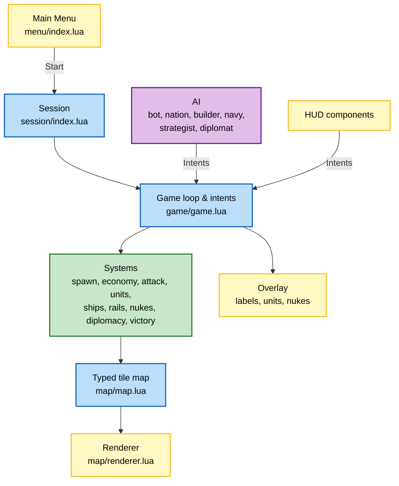

# Athena

A real-time territory conquest game inspired by [OpenFront.io](https://openfront.io), written in Lua with Love2D.

## Authors

- [@0xS4cha](https://github.com/0xS4cha)
- [@Bananoo](https://github.com/B4nJuice)

## Description

Athena is a clone of OpenFront. You spawn on one of the 100+ bundled maps alongside AI nations, bots and other players, then expand, trade, wage war, and launch nukes until one empire controls 80% of the land.

The game is multiplayer by default: a solo game starts a local server in a background thread and connects to it, like Minecraft. The simulation runs on a fixed 10 ticks-per-second loop with a seeded RNG. Every player action, human or AI, goes through an intent queue that is processed at the start of each tick. Tile data lives in LuaJIT FFI arrays (`uint8` terrain, `uint16` owner, `uint8` fallout), and the territory layer is a single `ImageData` patched pixel by pixel and uploaded once per frame.



## Setup

Athena runs on Love2D 11.3 or newer (it relies on `ImageData:getFFIPointer`).

```bash
love .
```

## Gameplay

New to the game? Press **Tutorial** in the main menu: it starts a solo game on Iceland against a few easy tribes, with a longer spawn phase and enough gold for a first city. A panel walks you through nine steps (spawning, starting, expanding, balancing troops and workers, sizing attacks, building a city, attacking a tribe and reading the map layers); each step completes on its own as soon as you do it, and can be skipped.

- **Spawn phase**: click anywhere on land to choose your starting location, then press `Space` or wait for the countdown.
- **Population**: your maximum population grows with your territory and your cities. Growth is fastest when you are far from the cap.
- **Troops / Workers**: the slider splits your population. Troops attack and defend; workers produce gold.
- **Attacks**: left-click a neighbour (or the wilderness) to send `Attack Ratio` percent of your troops. The front advances tile by tile. Each tile costs troops depending on terrain (plains < highland < mountain), fallout, the defender's troop density, defense posts, and whether the defender is a traitor. Attacks can be retreated from the Empire panel, and opposite attacks cancel each other out.
- **Biomes**: land is plains, desert, mountain or snow, derived from elevation and latitude. Each biome has a base conquest cost, plus an adaptation penalty that fades as that biome makes up a larger share of your land (full adaptation at 20%). A desert empire struggles to push into snow until it owns some. Your adaptation appears in the Empire panel, and hovering a tile shows your cost multiplier.
- **Boats**: transport ships leave from your **military ports** (2 boats per port, 6 at most). Left-click a coast you do not border to invade it. Without a military port you cannot leave your continent.
- **Capital**: your spawn becomes your capital (+population, defense bonus around it). If it falls, you lose 15% of your troops and your growth and income are halved for 60 s, then a new capital is founded.
- **Supply lines**: attacks get more expensive the farther they are from your capital, cities, military ports and finished rail tracks (up to x3). Toggle the Supply layer with `5` to see your supply range. Hovering a tile shows the multiplier.
- **Naval blockade**: an enemy warship within 18 tiles of a port blockades it. A blockaded trade port stops trading, a blockaded military port cannot launch invasions or build warships. Right-click > Send Warship Here dispatches your nearest warship to a place.
- **Threat map**: press `6` to colour your borders by how dangerous each neighbour is, from green to blinking red. The score weighs their troops (estimated if you cannot observe them) against yours, how much they dislike you, whether they are attacking you, have marked you as a target or are traitors, and whether a pact protects you. Arrows show where the strongest threats would come from.
- **Diplomatic map**: press `7` to recolour every nation by its relation to you: ally, at war, pact, traitor, hostile, friendly, neutral or tribe. It is drawn with a palette shader, so switching it on stays smooth even on the largest maps.
- **Hidden intel**: structures are drawn as small pixel buildings on the map, readable only when zoomed in. Enemy structures, ships and nukes are visible only within 35 tiles of your or your allies' territory or 55 tiles of your warships. Missile silos and SAM launchers stay hidden unless a radar sweeps them. AI nations play under the same fog: they need to have seen a capital or a city to nuke it precisely, otherwise they fire blind around the centre of the nation. The troops of nations you do not observe (not you, an ally, a neighbour of you or your allies, or under one of your radars) are only shown as rough estimates like "~300K".
- **Buildings** (right-click > Build), paid in gold with escalating costs:
  - City: raises your maximum population.
  - Trade Port: sends trade ships to nearby trade ports, so both sides earn gold. It is also a rail station.
  - Military Port: launches invasions overseas and builds warships.
  - Factory: lays pixel rail tracks across your own land to your cities and trade ports; trains generate gold.
  - Farm: only on plains. Raises your maximum population and speeds up growth (diminishing with each extra farm), with no upkeep.
  - Mine: only on mountains or deserts. Produces a steady flow of gold, 50% more on mountains, so the biomes that are hardest to conquer finally pay off.
  - Barracks: speeds up population growth, trains your armies (each barracks lowers conquest costs, up to -25%) and extends your supply lines. It costs gold upkeep every tick; without the gold to pay, the bonuses stop.
  - Radar: sweeps a 110-tile radius (165 on a mountain) and leaves fading echoes of every enemy structure, ship and nuke its beam passes over. It is the only way to spot enemy missile silos and SAM launchers. Radars share their picture with your allies, are visible to enemy radars from twice their range, cost gold upkeep and are destroyed when captured.
  - Defense Post: raises the cost of attacking nearby tiles.
  - Missile Silo: launches nukes.
  - SAM Launcher: intercepts nukes aimed inside its range.
  - Nuke warning: you only learn about a nuke aimed at you or your allies once it is detected, either by a radar (yours or an ally's) or when it enters your vision. A radar covering the enemy silo warns you at launch. The warning shows a countdown, the blast zone and the missile's path.
  - Warship: built at a military port; patrols, sinks transports, captures trade ships, and fights other warships.
- **Nukes** (right-click > Launch Nuke):
  - Atom Bomb, Hydrogen Bomb, and MIRV (splits into many warheads over the target nation).
  - Hovering a bomb in the menu previews its blast zone on the map: expected destroyed tiles, enemy land, friendly fire (your and your allies' tiles blink in white), known buildings hit, flight time from the silo that will fire, and the known enemy SAMs able to intercept it. Picking a bomb enters aiming mode: the preview follows the mouse, left click launches, right click or Escape cancels.
  - Nuked land loses its owner and gets fallout, which slowly decays and doubles conquest costs.
- **Diplomacy** (right-click on another nation):
  - Request or accept an alliance; alliances expire after 5 minutes.
  - Propose a non-aggression pact: neither side can attack the other by land or sea for 10 minutes. Ending a pact gives 30 s of notice and no penalty; nuking a pact partner breaks it and marks you as a traitor.
  - Break an alliance, which marks you as a traitor and halves your defense for 30 s.
  - Embargo, donate troops or gold to allies, mark a player as a target for your allies, send emojis.
  - Request a loan (100K, 500K or 2M gold) from any nation. The lender can lend for free, demand 10% or 25% interest (the borrower then accepts or declines the terms), or refuse. Loans are repaid automatically in installments over 5 minutes, or early from the Empire panel. Whatever is still owed at the deadline is a default: the borrower is marked as a traitor and loses the lender's trust.
- **Victory**: control 80% of the land, or be the last nation standing.
- **End of game stats**: the victory and defeat screens chart your share of the land over time against your three strongest rivals, and list your peak and final territory, tiles captured, attacks launched, buildings, nukes launched and nations eliminated. The history is part of the simulation (sampled every 5 seconds), so it survives reconnections and snapshots.

## Networking

Athena mixes an authoritative tick-lockstep with snapshots. The server owns the game: it runs the full simulation, the AI of every bot and nation, and validates every action.

- **Tick frames**: every tick the server sends `frame { t, c, h }` to every client, even when nobody acted. `c` holds the validated commands of that tick (human intents and the AI decisions taken by the server), `h` a 32-bit state hash every 10 ticks. A client only advances its local simulation when it has the frame for its next tick.
- **Intents**: clients send intents at any time with a sequence number. The server sanitizes them (types, ranges, ownership) and checks the game rules (enough gold, shared border, ready silo, free spawn tile...). A refused intent is answered with `reject { seq, reason }`, an accepted one comes back inside a frame.
- **Optimistic UI**: the grid and the troop counters are never predicted. While an intent is in flight the client draws a ghost layer instead: dashed attack, boat and nuke lines, a blinking building on its future tile, and the troop slider at its new value. The ghost disappears when the command is applied from its frame.
- **Determinism**: AI decisions only run on the server with their own RNG, so clients never need to agree on them. The simulation avoids libm transcendental functions (`src/core/dmath.lua`), breaks ties by tile or id, and never lets iteration order change the result (attack fronts use a hashed jitter instead of the RNG). The state hash combines an incremental XOR hash of the ownership grid with the integer resources of every player. A client whose hash differs asks for a resync.
- **Catch-up**: the server keeps the last 256 frames. After a short disconnection the client rejoins with the last tick it has and replays the missing frames in a burst, several ticks per rendered frame. If it is too far behind (more than 100 ticks), desynchronized or restarted, the server sends a snapshot instead: the ownership and fallout grids in run-length encoding plus the full game state graph, zlib compressed (about 100 to 200 KB), followed by the frames since that snapshot. Snapshots are cached and rebuilt at most every 200 ticks.
- **Solo controls**: pause and game speed are server commands, only accepted in games with a single human.
- **Ping**: the server broadcasts the round-trip time of every room member every 2 seconds. In game, a signal meter next to the clock shows your own ping (hidden in pure solo games), the leaderboard shows a colored dot next to each human player, and the lobby lists everyone's ping.

### LAN games

Turn on **Open to LAN** in New Game and press **Host LAN game**: the local server then listens on your network (UDP 6789) and announces the room every second with a UDP broadcast on port 6788. You land in the lobby, pick the map and start once your friends are in. On the other computers, the **Multiplayer** screen lists the LAN games it hears about; click one to join it directly.

### Lobby

- Pick your color and flag (a country code such as `fr` or `jp`) on the Multiplayer screen; they are used in the lobby and in game. Colors are unique within a room, and clicking your own player chip in the lobby cycles to the next free color.
- Rooms can be protected by a password typed before creating or joining them; locked rooms show a padlock.
- Every guest marks themselves ready; the host can only start once everyone is ready, and can kick a player by clicking their chip.

### Chat

- The lobby has a chat box next to the map preview: click it, type and press `Enter`.
- In game, press `Enter` to open the chat, `Tab` to switch between everyone and your allies, `Enter` to send and `Escape` to cancel. New messages show in the bottom left corner for a few seconds. The chat only appears when the game has more than one human player.
- The server trims messages to 160 characters, refuses more than 5 messages in 5 seconds, and only delivers ally messages to the sender's allies. It keeps the last 40 public messages of a room, so players who join the lobby or reconnect to a game get the history.

### Dedicated server

```bash
love . --server --port 6789
```

The Docker image (`Dockerfile`) and `make standalone-server` package the same server with the simulation and the maps. Players connect from **Multiplayer** in the main menu.

## Pixel Art

Everything on the map is drawn on the tile grid: buildings, rails, ships with their wake, troops marching to the front, combat flashes, nukes with smoke trails, fireballs, mushroom clouds and scorched craters. The interface uses the [Jersey 10](https://fonts.google.com/specimen/Jersey+10) pixel font (SIL Open Font License, see `assets/fonts/OFL.txt`).

## Controls

| Input | Action |
| --- | --- |
| Left click | Spawn / attack / send boat |
| Right click | Context menu |
| Right drag | Move the camera |
| Mouse wheel | Zoom |
| `Space` | Start the game during the spawn phase |
| `P` | Pause |
| `+` / `-` | Change game speed (x1, x2, x4, x8) |
| `1` `2` `3` `4` `5` | Toggle terrain, territories, units, names, supply |
| `Enter` | Open the chat in multiplayer (`Tab` switches between all and allies) |
| `H` | Controls help |
| `Escape` | Settings |

Drag a panel by its header to move it. Positions are saved in `hud_config.txt`, and menu choices in `menu_config.txt`, both in the Love2D save directory.

## Command Line

| Flag | Description |
| --- | --- |
| `--map assets/maps/europe/` | Map to use with `--autostart` or `--ci` |
| `--bots 100` | Number of bots (wild tribes) |
| `--nations on\|off` | Spawn the AI nations listed in the map manifest |
| `--difficulty easy\|medium\|hard` | Nation AI difficulty |
| `--seed 42` | RNG seed |
| `--autostart` | Skip the menu and start a solo game on the local server |
| `--server` | Run a headless dedicated server instead of the game |
| `--port 6789` | Port of the dedicated server |
| `--connect host:port` | Connect to a server, create a room (or join `--room <id>`, `--room rejoin`) and start it once `--players` players are in |
| `--autoplay` | The nation AI also plays for you |
| `--ci` | Headless run: simulate `--ticks` ticks, render one frame, quit (exit code 1 on error) |
| `--ticks 600` | Number of ticks simulated by `--ci` |
| `--screenshot shot.png` | Save the `--ci` frame in the Love2D save directory |
| `--zoom 4` | Zoom on your empire before the `--ci` screenshot |
| `--frames 600` | Quit after N real frames, printing any error |
| `--menu` | Render the main menu to a screenshot and quit |

Example soak test:

```bash
love . --ci --autoplay --ticks 6000 --seed 42 --screenshot shot.png
```

## Project Structure

```
├─ main.lua                     # Love2D callbacks, CLI flags, CI mode, --server switch
├─ conf.lua
├─ server/                      # Entry point used to package the dedicated server
├─ assets/
│  ├─ maps/<name>/              # manifest.json, map.bin, map4x.bin, map16x.bin
│  ├─ flags/                    # Nation flags
│  └─ Icons/                    # UI and unit icons
└─ src/
   ├─ config/game.lua           # Every balance constant
   ├─ core/                     # Class, camera, logger, args, env, format, xorshift RNG, hash, dmath
   ├─ net/                      # Shared protocol: binary codec, intents validation, snapshots
   ├─ server/                   # Authoritative server: rooms, host, dedicated runner, local thread
   └─ modules/
      ├─ index.lua              # Module loader and callback dispatch
      ├─ session/               # Starts and stops games, camera, world input
      ├─ menu/                  # Main menu
      ├─ map/
      │  ├─ map.lua             # FFI tile arrays and spatial helpers
      │  ├─ renderer.lua        # Terrain and territory images
      │  └─ pathfinding.lua     # Water A* with coarse grid and connectivity components
      ├─ player/                # Player state and color palette
      ├─ game/
      │  ├─ game.lua            # Tick loop, intents, events, ownership changes
      │  ├─ interaction.lua     # Left click and context menu actions
      │  ├─ overlay.lua         # Labels, buildings, ships, rails, nukes
      │  └─ systems/            # spawn, economy, attack, units, ships, rails,
      │                         # nukes, diplomacy, ai, victory
      ├─ ai/                    # bot, nation, builder, navy, strategist, diplomat (server only)
      ├─ multiplayer/           # Connection, local server thread, client tick-lockstep
      └─ hud/                   # Style, context menu, panels
```

## Builds

```bash
make build            # Windows, macOS and Linux
make build-windows    # or build-macos / build-linux for a single platform
```

The Makefile downloads [love-build](https://github.com/ellraiser/love-build) for the machine you run it on (macOS or Linux) and writes `Athena-windows.zip` (`Athena.exe`), `Athena-macos.zip` (`Athena.app`, unsigned), `Athena-linux.zip` and `Athena.love` to `dist/<version>/`. Development files (tests, Docker and build tooling) are left out of the packages through the `ignore` list of `build.lua`.

Every packaged game is also a dedicated server: run it with `--server --port 6789` (for example `Athena.exe --server`).

The **Builds** workflow packages every push to `main` and uploads the three archives as workflow artifacts. Pushing a `v*` tag also attaches them to a GitHub release.

## Tests

```bash
love . --test                     # or: make test
love . --test --filter network    # only the cases whose name contains "network"
```

The suite runs headless and exits with code 1 when a case fails, so the CI runs it on every push:

- `codec_test`, `hash_test`: the binary protocol round-trips values bit for bit, and the incremental ownership hash is order independent.
- `intents_test`: the server sanitizes intents (sender slot, stripped fields, quantized ratios) and enforces the game rules.
- `determinism_test`: a server with the AI, a client and two clients restored from snapshots keep the same state hash for 700 ticks; the AI only runs on the authority.
- `network_test`: real ENet clients against an in-process server follow the frames without desync, get refused intents answered, catch up after a short disconnection and resynchronize or rejoin from a snapshot.
- `lobby_test`: room passwords, unique colors, flags, kicks, the ready check, and the chat (history, sanitizing, rate limit, ally messages).

## Map Format

Each byte of `map.bin` is one tile:

- **Bit 7**: land
- **Bit 6**: shoreline
- **Bit 5**: ocean
- **Bits 0-4**: magnitude (elevation or depth). On land, below 10 is plains, below 20 is highland, and the rest is mountain.

## Resources

- [OpenFront.io](https://openfront.io), the original game and the source of the map assets
- [Love2D](https://love2d.org/)
- [LuaJIT FFI](https://luajit.org/ext_ffi.html)

## Feedback

If you have feedback or feature requests, open an issue or contact the project author.
