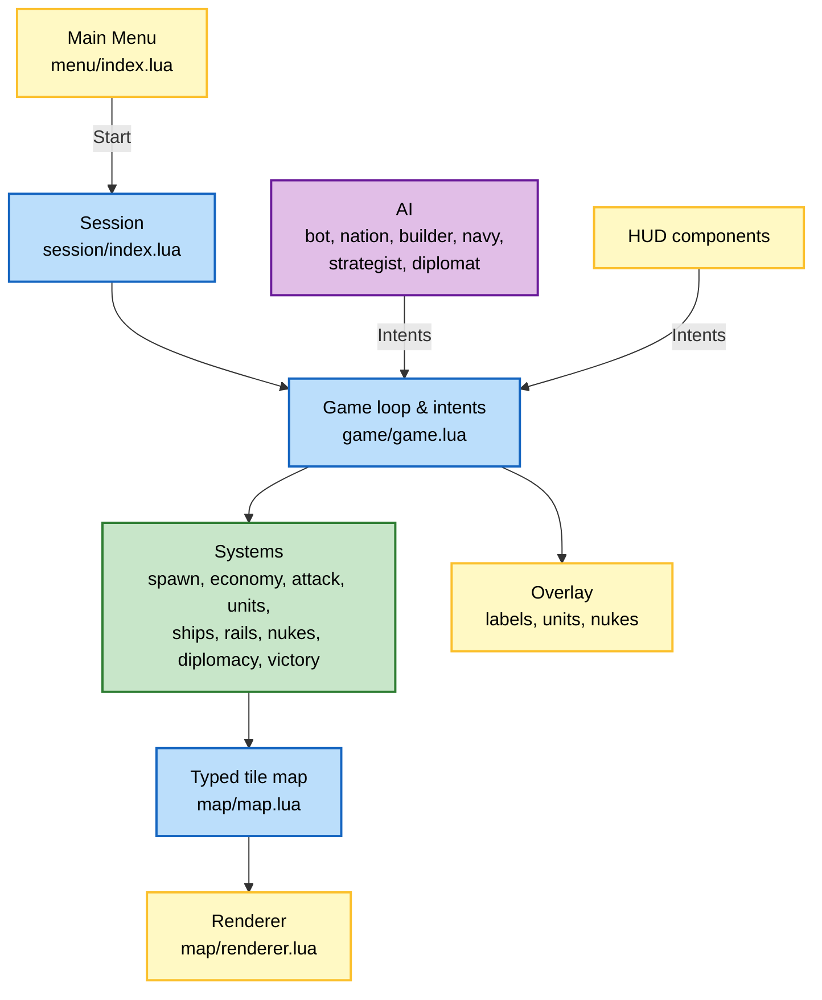

# Technical guide

[Back to the README](../README.md)

## Overview

Athena is a clone of OpenFront. You spawn on one of the 100+ bundled maps alongside AI nations, bots and other players, then expand, trade, wage war, and launch nukes until one empire controls 80% of the land.

The game is multiplayer by default: a solo game starts a local server in a background thread and connects to it, like Minecraft. The simulation runs on a fixed 10 ticks-per-second loop with a seeded RNG. Every player action, human or AI, goes through an intent queue that is processed at the start of each tick. Tile data lives in LuaJIT FFI arrays (`uint8` terrain, `uint16` owner, `uint8` fallout), and the territory layer is a single `ImageData` patched pixel by pixel and uploaded once per frame.



## Networking

Athena mixes an authoritative tick-lockstep with snapshots. The server owns the game: it runs the full simulation, the AI of every bot and nation, and validates every action.

- **Tick frames**: every tick the server sends `frame { t, c, h }` to every client, even when nobody acted. `c` holds the validated commands of that tick (human intents and the AI decisions taken by the server), `h` a 32-bit state hash every 10 ticks. A client only advances its local simulation when it has the frame for its next tick.
- **Intents**: clients send intents at any time with a sequence number. The server sanitizes them (types, ranges, ownership) and checks the game rules (enough gold, shared border, ready silo, free spawn tile...). A refused intent is answered with `reject { seq, reason }`, an accepted one comes back inside a frame.
- **Optimistic UI**: the grid and the troop counters are never predicted. While an intent is in flight the client draws a ghost layer instead: dashed attack, boat and nuke lines, a blinking building on its future tile, and the troop slider at its new value. The ghost disappears when the command is applied from its frame.
- **Determinism**: AI decisions only run on the server with their own RNG, so clients never need to agree on them. The simulation avoids libm transcendental functions (`src/core/dmath.lua`), breaks ties by tile or id, and never lets iteration order change the result (attack fronts use a hashed jitter instead of the RNG). The state hash combines an incremental XOR hash of the ownership grid with the integer resources of every player. A client whose hash differs asks for a resync.
- **Catch-up**: the server keeps the last 256 frames. After a short disconnection the client rejoins with the last tick it has and replays the missing frames in a burst, several ticks per rendered frame. If it is too far behind (more than 100 ticks), desynchronized or restarted, the server sends a snapshot instead: the ownership and fallout grids in run-length encoding plus the full game state graph, zlib compressed (about 100 to 200 KB), followed by the frames since that snapshot. Snapshots are cached and rebuilt at most every 200 ticks.
- **Solo controls**: pause and game speed are server commands, only accepted in games with a single human.
- **Ping**: the server broadcasts the round-trip time of every room member every 2 seconds. In game, a signal meter next to the clock shows your own ping (hidden in pure solo games), the leaderboard shows a colored dot next to each human player, and the lobby lists everyone's ping.

### LAN games

Turn on **Open to LAN** in New Game and press **Host LAN game**: the local server then listens on your network (UDP 6789) and announces the room every second with a UDP broadcast on port 6788. You land in the lobby, pick the map and start once your friends are in. On the other computers, the **Multiplayer** screen lists the LAN games it hears about; click one to join it directly.

### Lobby

- Pick your color and flag (a country code such as `fr` or `jp`) on the Multiplayer screen; they are used in the lobby and in game. Colors are unique within a room, and clicking your own player chip in the lobby cycles to the next free color.
- Rooms can be protected by a password typed before creating or joining them; locked rooms show a padlock.
- Every guest marks themselves ready; the host can only start once everyone is ready, and can kick a player by clicking their chip.

### Chat

- The lobby has a chat box next to the map preview: click it, type and press `Enter`.
- In game, press `Enter` to open the chat, `Tab` to switch between everyone and your allies, `Enter` to send and `Escape` to cancel. New messages show in the bottom left corner for a few seconds. The chat only appears when the game has more than one human player.
- The server trims messages to 160 characters, refuses more than 5 messages in 5 seconds, and only delivers ally messages to the sender's allies. It keeps the last 40 public messages of a room, so players who join the lobby or reconnect to a game get the history.

### Dedicated server

```bash
love . --server --port 6789
```

The Docker image (`Dockerfile`) and `make standalone-server` package the same server with the simulation and the maps. Players connect from **Multiplayer** in the main menu.

## Command Line

| Flag | Description |
| --- | --- |
| `--map assets/maps/europe/` | Map to use with `--autostart` or `--ci` |
| `--bots 100` | Number of bots (wild tribes) |
| `--nations on\|off` | Spawn the AI nations listed in the map manifest |
| `--teams 2` | Number of teams: 2, 3 or 4, or 0 for a free for all |
| `--difficulty easy\|medium\|hard` | Nation AI difficulty |
| `--seed 42` | RNG seed |
| `--autostart` | Skip the menu and start a solo game on the local server |
| `--mode blitz` | Game mode to use with `--autostart`, `--ci` or `--connect` |
| `--replay <file>` | Watch a file of the `replays/` save directory |
| `--server` | Run a headless dedicated server instead of the game |
| `--port 6789` | Port of the dedicated server |
| `--connect host:port` | Connect to a server, create a room (or join `--room <id>`, `--room rejoin`) and start it once `--players` players are in |
| `--autoplay` | The nation AI also plays for you |
| `--ci` | Headless run: simulate `--ticks` ticks, render one frame, quit (exit code 1 on error) |
| `--ticks 600` | Number of ticks simulated by `--ci` |
| `--screenshot shot.png` | Save the `--ci` frame in the Love2D save directory |
| `--zoom 4` | Zoom on your empire before the `--ci` screenshot |
| `--frames 600` | Quit after N real frames, printing any error |
| `--menu` | Render the main menu to a screenshot and quit |

Example soak test:

```bash
love . --ci --autoplay --ticks 6000 --seed 42 --screenshot shot.png
```

## Project Structure

```
├─ main.lua                     # Love2D callbacks, CLI flags, CI mode, --server switch
├─ conf.lua
├─ server/                      # Entry point used to package the dedicated server
├─ assets/
│  ├─ maps/<name>/              # manifest.json, map.bin, map4x.bin, map16x.bin
│  ├─ flags/                    # Nation flags
│  └─ Icons/                    # UI and unit icons
└─ src/
   ├─ config/game.lua           # Every balance constant
   ├─ core/                     # Class, camera, logger, args, env, format, xorshift RNG, hash, dmath
   ├─ net/                      # Shared protocol: binary codec, intents validation, snapshots
   ├─ server/                   # Authoritative server: rooms, host, dedicated runner, local thread
   └─ modules/
      ├─ index.lua              # Module loader and callback dispatch
      ├─ session/               # Starts and stops games, camera, world input
      ├─ menu/                  # Main menu; screens/multiplayer/ holds the connect, browse and lobby phases
      ├─ map/
      │  ├─ map.lua             # FFI tile arrays and spatial helpers
      │  ├─ renderer.lua        # Terrain and territory images
      │  └─ pathfinding.lua     # Water A* with coarse grid and connectivity components
      ├─ player/                # Player state and color palette
      ├─ game/
      │  ├─ game.lua            # Tick loop, intents, events, ownership changes
      │  ├─ interaction.lua     # Left click and context menu actions
      │  ├─ rules.lua           # Game modes and custom rules
      │  ├─ overlay.lua         # Draws the map overlay from overlay/
      │  ├─ overlay/            # labels, buildings, radar, nukes, orders, threats, units, battle
      │  └─ systems/            # spawn, economy, attack, units, ships, rails,
      │                         # nukes, diplomacy, teams, ai, victory
      ├─ replay/                # Replay files, recorder and player
      ├─ audio/                 # Sound synthesizer, recipes and event cues
      ├─ ai/                    # bot, nation, builder, navy, strategist, diplomat (server only)
      ├─ multiplayer/           # Connection, local server thread, client tick-lockstep
      └─ hud/                   # Style, context menu, panels
```

## Builds

```bash
make build            # Windows, macOS and Linux
make build-windows    # or build-macos / build-linux for a single platform
```

The Makefile downloads [love-build](https://github.com/ellraiser/love-build) for the machine you run it on (macOS or Linux) and writes `Athena-windows.zip` (`Athena.exe`), `Athena-macos.zip` (`Athena.app`, unsigned), `Athena-linux.zip` and `Athena.love` to `dist/<version>/`. Development files (tests, Docker and build tooling) are left out of the packages through the `ignore` list of `build.lua`.

Every packaged game is also a dedicated server: run it with `--server --port 6789` (for example `Athena.exe --server`).

The **Builds** workflow packages every push to `main` and uploads the three archives as workflow artifacts. Pushing a `v*` tag also attaches them to a GitHub release.

## Tests

```bash
love . --test                     # or: make test
love . --test --filter network    # only the cases whose name contains "network"
```

The suite runs headless and exits with code 1 when a case fails, so the CI runs it on every push:

- `codec_test`, `hash_test`: the binary protocol round-trips values bit for bit, and the incremental ownership hash is order independent.
- `intents_test`: the server sanitizes intents (sender slot, stripped fields, quantized ratios) and enforces the game rules.
- `determinism_test`: a server with the AI, a client and two clients restored from snapshots keep the same state hash for 700 ticks; the AI only runs on the authority.
- `network_test`: real ENet clients against an in-process server follow the frames without desync, get refused intents answered, catch up after a short disconnection and resynchronize or rejoin from a snapshot.
- `balance_test`: diminishing cities and the housing cap, the factory link limit, the diminishing train income, the administration falloff, the diminishing, land-limited farms and mines, and the indicators of what each structure brings.
- `ai_test`: AI personalities are the same on the server and every client; AI lenders, pact negotiations, pact notices before an attack, and borrowing and early repayment.
- `military_test`: bunker shelter and direct hits, submarine stealth, sonar detection, depth charges and torpedoes.
- `audio_test`: every sound renders audible, bounded and identical each time, events only sound for the local player, and observing the simulation does not change it.
- `team_test`: team assignment and balance, permanent alliances, refused betrayals, pacts, coalitions and nukes between teammates, shared victory, determinism and snapshots, and picking a side in the lobby.
- `coalition_test`: coalition founding, invitations, attack and defense bonuses, permanent alliances, desertion, dissolution, server validation and snapshots.
- `hud_test`: the build bar shows the bound keys, what you can afford and the building being placed; the tutorial steps, navigation and markers.
- `surrender_test`: land, buildings, ships and attacks of a surrendering player, server validation, last player and team victories, determinism and snapshots.
- `rematch_test`: votes and cancellations, a fresh synchronized game, a voter left alone, and refusal during a game.
- `rules_test`: sanitizing and presets, starting resources, income, disabled nukes and diplomacy (AI included), win ratio, time limit, and rules in a real room.
- `replay_test`: a replay rebuilds the exact game through its file, with rules, teams and a surrender; controls and seeking; games that are not saved, pruning, damaged, foreign and tampered files, and hash mismatches.
- `research_test`: the catalog and its balance caps, costs, queue, doctrines, payment and slowdown, sharing, stolen plans, effects on every system, the AI, the rule, layout, determinism and snapshots.
- `lobby_test`: room passwords, unique colors, flags, kicks, the ready check, and the chat (history, sanitizing, rate limit, ally messages).

## Map Format

Each byte of `map.bin` is one tile:

- **Bit 7**: land
- **Bit 6**: shoreline
- **Bit 5**: ocean
- **Bits 0-4**: magnitude (elevation or depth). On land, below 10 is plains, below 20 is highland, and the rest is mountain.
